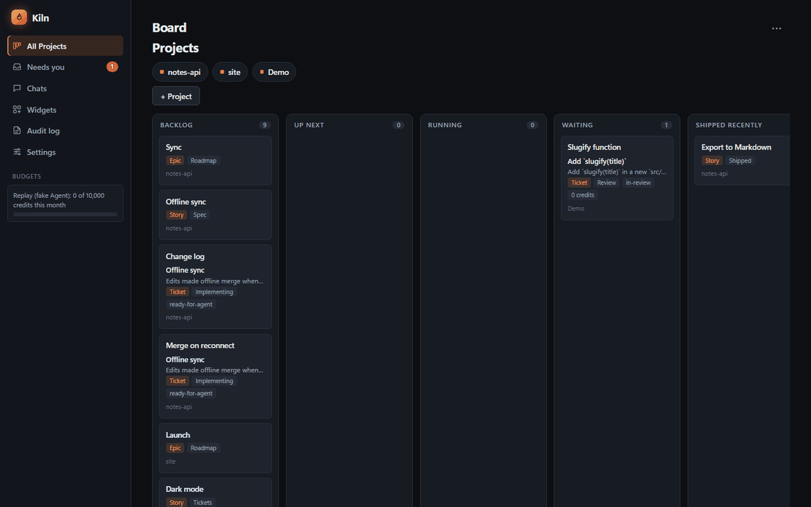
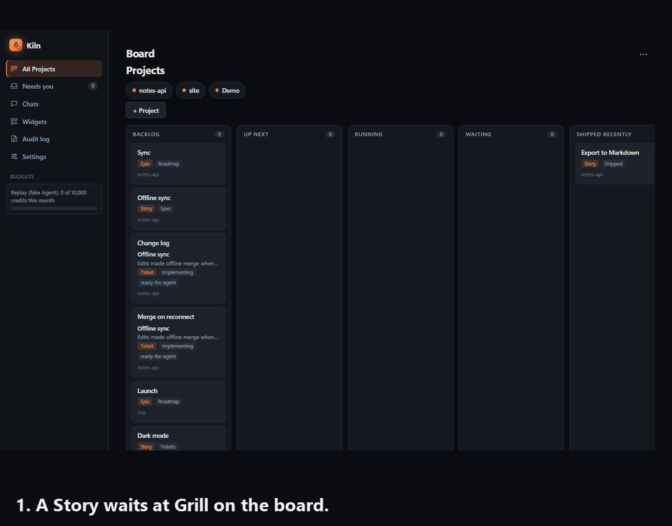
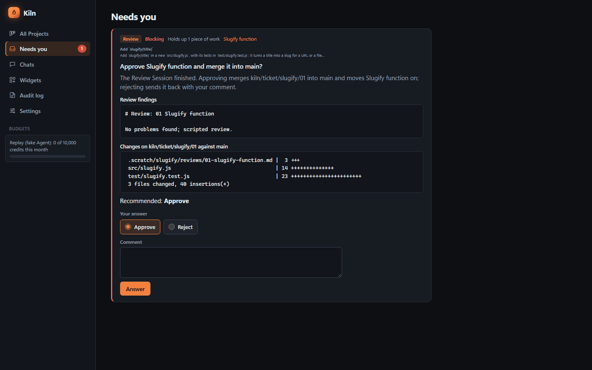
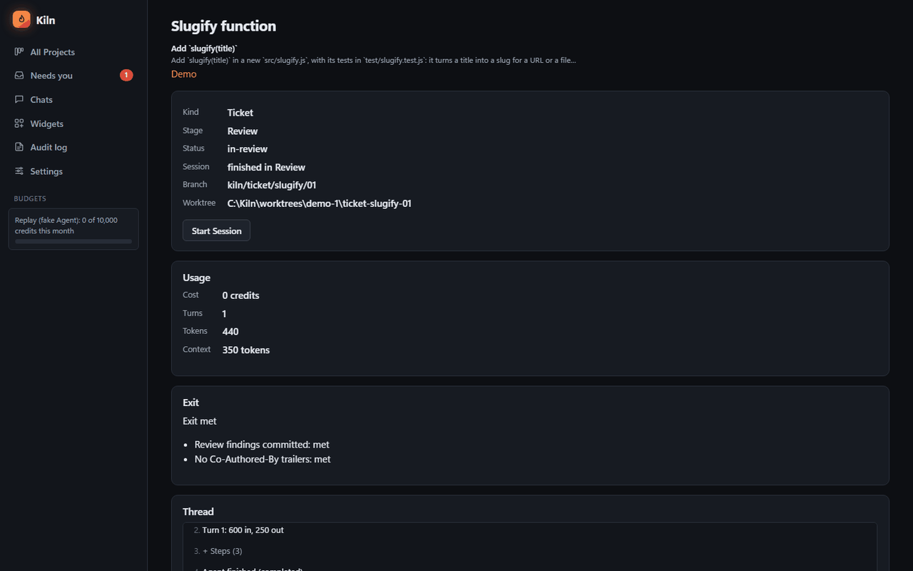
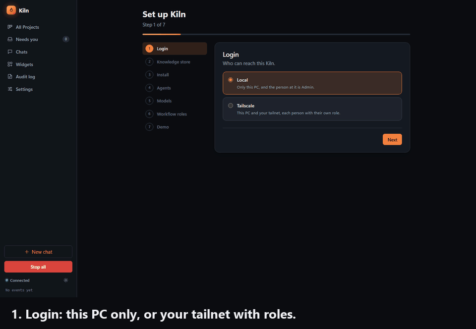
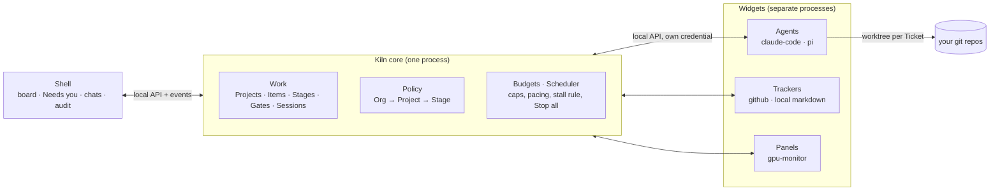

# Kiln

**A local board that runs coding agents across all your projects, and only interrupts you when a decision is yours.**



You write a Story. Kiln grills you on it, writes the spec, cuts it into Tickets, gives each Ticket its own git worktree and a fresh Agent Session, checks the exit (commits, clean tree, tests green), merges, and asks you to approve at each Gate. Every Project on one board. Every question in one inbox. Budgets on by default, so a runaway Agent costs you a Stop, not a bill.

## Watch a Story ship

The demo below is Kiln's Replay mode: a scripted Agent plays one Story, "Add `slugify(title)`", from Grill to Shipped on a dev instance. No models, no cost, same screens.



1. **Grill.** The griller Agent asks you the questions a good tech lead would, before anyone writes code.
2. **Spec Gate.** The spec lands in Needs you with a recommendation. You approve, reject or comment.
3. **Tickets.** The Story becomes Tickets with dependencies. Each Ticket gets a branch and a worktree.
4. **Implement and review.** A fresh Session per Stage. The Exit is checked, not trusted: commits, clean tree, tests pass, no `Co-Authored-By` trailers.
5. **Review Gate.** Findings and the diff stat wait for you. Approve, and Kiln merges to main. The blocked Ticket unblocks and starts on its own.
6. **Shipped.** Both Tickets merged, the Story moves to Shipped recently, and the board is quiet again.

## One inbox for everything that needs a human



Asks from every Agent on every Project land in **Needs you**: grill questions, permission requests, Gates. Each one carries the Agent's recommendation, so a decision is usually one click. Nothing moves past a Gate without you.

## Every Session, accounted for



Each Ticket page shows its branch and worktree, what the Session spent (credits, turns, tokens, context), which Exit checks were met, the thread of events and a Digest of what happened. The audit log keeps every action.

## Set up in seven steps



First run opens a wizard. Pick who can log in, where Digests go, what pays for the work, which Agents to install, a Budget per model and a model per Workflow role. Each step saves as you go, and you can come back to any of it from Settings.

## How it fits together



- **The core is small and owns the work.** Projects, Items (Epic, Story, Ticket), Workflow Stages, Gates and Sessions. One model, many views ([ADR 0001](docs/adr/0001-work-is-core-one-model-many-views.md)).
- **A fresh Session per Stage, a worktree per Ticket.** Kiln checks the Exit and merges, or opens a pull request ([ADR 0002](docs/adr/0002-fresh-session-per-stage.md), [ADR 0003](docs/adr/0003-worktree-per-ticket-checked-exits.md)).
- **Agents are Widgets.** Claude Code, Pi, or your own: a separate process the core installs, starts, supervises and talks to over its local API ([ADR 0004](docs/adr/0004-agents-are-widgets.md), [ADR 0007](docs/adr/0007-widgets-are-separate-processes.md)).
- **Kiln owns the Policy.** One layered Policy over abstract actions, translated by each Agent Widget into its tool's own settings. Permission requests become Asks ([ADR 0006](docs/adr/0006-kiln-owns-a-layered-policy.md)).
- **Budgets on by default.** Metered (credits or dollars), subscription (plan usage windows) and local (turns and time), with per-Session caps, pacing, reserves, a stall rule, a context alarm and Stop all.

The design lives in `.scratch/kiln-v1/spec.md`, the vocabulary in `GLOSSARY.md` and the decisions in `docs/adr/`.

## Try it in two minutes

No API key needed. The dev instance runs beside any Kiln you already have, on a free port with a throwaway data folder.

```powershell
git clone https://github.com/kennedml04/kiln.git
cd kiln
npm ci
npm run build
node packages/core/src/cli.ts dev
```

Open the URL it prints. The setup wizard's Demo step offers **Replay (no models)**; pick it, or start it later from the **Demo** Project with **Start demo**. Open the Story, start a Session, then answer its questions and approve the Gates in Needs you. **Stop all** halts everything at any time.

## Install

Kiln needs Node 24 or later, npm 11 and git. It is developed and tested on Windows.

```powershell
git clone https://github.com/kennedml04/kiln.git
cd kiln
npm ci
npm run build
node packages/core/src/cli.ts start
```

Then open http://localhost:8300. The setup wizard picks the login mode, the Knowledge store, the Budgets and the Agents.

To add a Project, press **+ Project** → Import on the board and pick its folder in the tree, or type its path. The tree shows only the browse roots and the Projects folder an Admin sets in Settings → Folders (a dev instance browses its own data folder). It skips hidden and system folders and never follows junctions. The folder must be the top of a git repo with a commit, on its default branch; otherwise Kiln refuses with the fix. It never switches branches for you. A folder that isn't a git repo yet gets an **Initialise as a git repo** button.

To start a Project from nothing, press **+ Project** → New and give it a name and a one-line description. The first time, it asks for the Projects folder and remembers it. Kiln makes `<Projects folder>\<name>` with a README, `.kiln/settings.json` and a `.gitignore`, runs `git init -b main`, and commits them once as Kiln, with no trailer. It registers the Project and opens a "What we're building" Story at Grill, seeded with the description. If a step fails, the error names it and the folder stays, unregistered; Create again carries on from that step.

The `kiln` CLI:

| Command | What it does |
| - | - |
| `kiln start`, `kiln stop`, `kiln status` | Run the core in the background, stop it, show its port and uptime |
| `kiln doctor` | Check the port, data folder, git, Widgets and Agents, and say how to fix each problem |
| `kiln restart` | Restart when idle: wait until no Session runs, then restart |
| `kiln startup on` | Start Kiln when you log in, with no window |
| `kiln dev` | A dev instance on a free port with a throwaway data folder |

The port defaults to 8300 (`--port` or `KILN_PORT`) and the data folder to `%LOCALAPPDATA%\Kiln` (`--data-dir` or `KILN_DATA_DIR`). The default login mode is local: localhost only, and the person at the PC is Admin. Tailscale login (`--login tailscale`) lets you reach the board from other devices on your tailnet.

## Widgets

A Widget is a folder with a `kiln-widget.json` Manifest that says what it provides (Agents, Trackers, panels) and what it needs (Asks, network domains, secrets, a data folder). Widgets are installed from this repo or from a private Widget source (a local folder or a private git repo), pinned in a lockfile, approved by a person, and started, stopped or updated without restarting the core.

First-party Widgets in `widgets/`:

- `claude-code`: the Claude Code Agent, through the Claude Agent SDK, with subscription quota readings.
- `pi`: the Pi Agent, for OpenAI, Anthropic or OpenRouter models with an API key.
- `github`: a GitHub Issues Tracker.
- `gpu-monitor`: a read-only NVIDIA GPU panel.

Widgets talk to the core only through its local API with their own credential. The TypeScript Widget SDK (`packages/widget-sdk`) has the Manifest types, the API client and the Agent and Tracker interfaces.

## Develop

```powershell
npm ci
npx playwright install chromium
npm test
```

`npm test` checks the lock file and banned patterns, builds the Shell, typechecks and runs every test. Tests start a real core on a free port with a throwaway data folder (`startTestKiln` from `@kiln/testing`) and never touch the live Kiln. Node runs the TypeScript directly, so only the Shell has a build step. `CLAUDE.md` has the rules agents follow in this repo.

The images in this README come from the Replay demo, photographed by a test. To remake them after a Shell change:

```powershell
node --test scripts/readme-media.test.ts scripts/readme-setup.test.ts
python -I scripts/readme-media.py
```

The tests write numbered frames to `docs/readme/shots/` (not committed); the script needs Pillow and writes `docs/readme/*.png`, `demo.gif` and `setup.gif`.

## License

MIT. See `LICENSE`.
